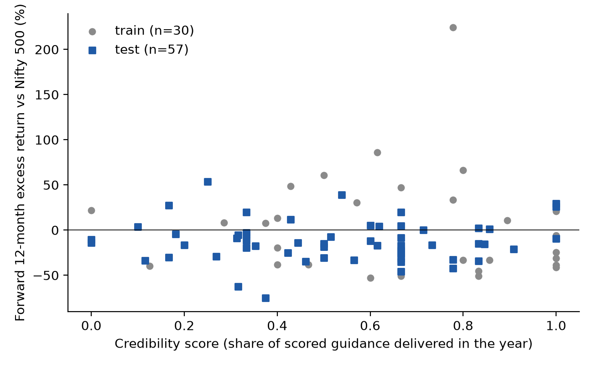

# Does management guidance credibility predict returns? Indian consumer and retail, FY22 to FY25

Research note, 2026-11-11. Every number here is printed by a script in this repo; `python -m credibility.trace`
checks that. Source files are named in brackets.

## Summary

- **Result: no evidence that the score predicts anything.** In the pre-registered test years (FY24 and FY25),
  the rank correlation between a company's guidance credibility score and its forward 12-month excess return
  over the Nifty 500 is -0.030, with a 95% interval of -0.342 to +0.260 (n=57 company-years, 34 companies).
- The same holds for next-year earnings: rank correlation -0.062, interval -0.417 to +0.272 (n=49, 30 companies).
- All intervals include zero, in the test set, the train set and pooled, across every robustness check.
  The intervals are wide. The study cannot rule out a modest effect in either direction.
- The dataset itself may be the more useful output: 6,959 guidance statements from 565 call transcripts of 41
  companies, each with a verbatim quote and page number, of which 1,107 could be scored against a reported
  outcome. Management delivered on 52.2% of the scored ones.

## Data

**Companies.** 40 listed Indian consumer and retail companies chosen for transcript coverage, plus Senco Gold,
the pilot case (41 in all). Segments: apparel and footwear 8, durables 10, home and paints 4, jewellery 4,
leisure 4, quick-service restaurants 5, retail 5. [reports/dataset_numbers.txt]

**Transcripts.** Earnings calls from Q1 FY22 to Q4 FY25, at most 16 per company. 565 transcripts were found and
readable, 87 were missing and 4 had no extractable text. A further 212 later calls were used only as sources
of reported outcomes. Three companies have fewer than 12 study transcripts: INDHOTEL, SENCO and TTKPRESTIG
(Senco listed in July 2023).

**Statements.** An agent read each transcript and recorded every forward-looking statement by management that
names a measurable outcome, with the verbatim quote and PDF page. A script confirms each quote appears on the
stated page of the stored transcript: 6,959 of 6,959 rows pass. Rules are in `docs/rubric.md`, frozen before
scoring.

**Scoring.** A second agent wrote, for each statement, the guided range and the reported outcome with its
source. The verdict (beat, met or missed) is then computed by code, not by the agent. A statement is scored
only if the outcome is a reported figure for the full guided period on the guided basis. Everything else is
marked not scorable, with the reason.

| Verdict | Statements |
|---|---|
| Beat | 151 |
| Met | 427 |
| Missed | 529 |
| Scored total | 1,107 (15.9% of all statements) |
| Not scorable | 5,523 |
| Not due yet | 329 |

Of the scored rows, 807 take the outcome from a later call transcript and 300 from the company's Screener.in
page. The scored share is steady across call years, from 13.5% to 17.3%. The low share is the main limit of
the dataset: most guidance is undated, directional, or about a metric the company never reports back.

**Checks on the scoring.**

- Against the earlier hand-built Senco study: where both studies scored the same statement, verdicts agree on
  33 of 37 (89.2%). [reports/phase1_senco_validation.txt]
- 64 rows that scoring agents flagged as doubtful were reviewed and moved to not scorable. Rows the agents
  did not flag were not reviewed one by one.
- A random sample of 50 scored statements is in `data/audit_sample.csv` for hand checking. A separate agent re-checked all 50
  against the transcripts: 44 were confirmed, 1 was wrong (the period was misread, though the verdict would
  not change) and 5 were doubtful on basis or period. The 6 rows were left as scored, so the sample stays an
  honest estimate of the error rate: roughly one scored row in eight is open to challenge.
  [data/audit_review.csv]

**Spread across companies.** Delivery rates differ a lot. Among companies with many scored statements, RBA
delivered on 82.0% (61 scored) and DOLLAR on 21.3% (89 scored). HAVELLS has no scorable statement at all.
The number of scored statements per company depends on how specifically management guides, so the score is
measured with very uneven precision.

## Method

Definitions were fixed in `docs/prereg.md` before any price data was downloaded.

- **Score.** For each company and fiscal year, the share of scored statements resolving in that year that
  were beat or met. A company-year needs at least 3 scored statements.
- **Return.** Stock return from 1 June after the fiscal year to 31 May of the next year, minus the Nifty 500
  return over the same window. Prices are from Yahoo Finance.
- **Earnings surprise.** Change in net profit over the next year, divided by sales. This is a random-walk
  proxy. No free consensus estimates exist for this sample.
- **Split.** Train FY22 and FY23, test FY24 and FY25. Nothing was tuned on the train set.
- **Tests.** Spearman rank correlation, and the mean outcome of the top half by score minus the bottom half
  within each year. Intervals are 95%, from 2,000 bootstrap draws that resample companies.

The panel has 113 company-years in FY22 to FY25; 87 meet the minimum and 26 are dropped. 14 company-years
have no earnings surprise because Screener has no usable profit or sales figure for them.
[reports/phase3_results.txt]

| Score year | n | Median score | Index return | Mean excess return | Median excess return |
|---|---|---|---|---|---|
| FY22 | 6 | 0.789 | 12.0% | 24.7% | 32.0% |
| FY23 | 24 | 0.667 | 33.9% | -1.3% | -25.4% |
| FY24 | 28 | 0.519 | 4.6% | -6.4% | -9.0% |
| FY25 | 29 | 0.600 | -0.8% | -18.1% | -15.5% |

FY22 is thin because the study starts with Q1 FY22 calls. The sample lagged the index in three of the four
windows.

## Results

Rank correlation of score with outcome, and top-half minus bottom-half spread. Brackets are 95% intervals.

| Outcome and sample | n | Companies | Spearman | Top minus bottom |
|---|---|---|---|---|
| Excess return, **test** | 57 | 34 | -0.030 [-0.342, +0.260] | +2.1% [-13.0%, +14.7%] |
| Excess return, train | 30 | 24 | -0.174 [-0.425, +0.125] | -4.5% [-66.7%, +40.2%] |
| Excess return, pooled | 87 | 37 | -0.076 [-0.302, +0.138] | -1.0% [-25.1%, +15.9%] |
| Earnings surprise, **test** | 49 | 30 | -0.062 [-0.417, +0.272] | +0.1% [-2.0%, +2.8%] |
| Earnings surprise, train | 28 | 22 | -0.194 [-0.545, +0.184] | -6.1% [-14.3%, +7.9%] |
| Earnings surprise, pooled | 77 | 33 | -0.071 [-0.332, +0.170] | -2.1% [-5.9%, +3.2%] |

The hypothesis was a positive relation. The point estimates of the correlation are slightly negative in
every row. None is distinguishable from zero.

*Figure 1. One point per company-year with at least 3 scored statements (n=87). Made by
`python -m credibility.figure`.*

**Robustness, test set only.** These were named in advance and are reported whatever they show.

| Check | Outcome | n | Spearman |
|---|---|---|---|
| Two-year score | Excess return | 67 | +0.204 [-0.034, +0.402] |
| Two-year score | Earnings surprise | 56 | -0.139 [-0.420, +0.150] |
| At least 5 scored statements | Excess return | 48 | -0.024 [-0.351, +0.284] |
| At least 5 scored statements | Earnings surprise | 42 | -0.094 [-0.456, +0.251] |
| Excess over sample mean return | Excess return | 57 | -0.050 [-0.353, +0.241] |

The two-year score has the only positive estimate for returns, +0.204, and its interval still includes zero.
With two outcomes and several checks, one such reading is expected by chance. On the train set the same
check gives -0.191. It is not evidence of an effect.

## What this does and does not show

It shows that, in this sample and on these definitions, how often management hit its own numeric guidance in
a year does not rank companies by their next year's excess return or profit change.

It does not show that credibility is irrelevant. The test is weak for reasons that were stated in advance
and some found on the way:

- **Small sample.** Two test years and 34 companies. An interval of -0.342 to +0.260 is compatible with no
  effect and with a moderate one.
- **Noisy score.** Many company-years rest on 3 to 5 scored statements. Raising the minimum to 5 does not
  change the picture, but it also cuts the sample.
- **What gets scored is not random.** Companies that guide in specific, dated numbers supply most of the
  scored rows. Statements scored against Screener figures are mostly revenue and margin targets; those
  scored from calls are mostly store openings, store counts and costs.
- **Scoring conventions.** Capex guidance is scored lower-is-better, so under-spending counts as a beat.
  Multi-year guidance is scored on its weakest year. Both are defensible and both could be argued the other
  way.
- **Benchmark.** The Nifty 500 series is a price index, while stock returns include dividends. This lifts
  every excess return by about the index dividend yield and does not affect the ranking.
- **Corporate actions.** Yahoo's adjusted prices do not correct for the Raymond and ABFRL demergers. ABFRL's
  FY24 window shows the largest negative return in the panel for that reason. Rank tests limit the damage but
  do not remove it.
- **Earnings proxy.** A random-walk surprise is not what the market expected. The hotel recovery after FY22
  produces large positive values that have nothing to do with guidance.
- **Selection.** Companies were picked for transcript coverage, not at random, and all are survivors.
- **Agent extraction.** Statements and outcomes were read by a language model under a fixed rubric. Quotes
  are verified by script; the judgment of what counts as the guided range is not.

## Reproducing

`python -m credibility.check` verifies quotes and sources. `python -m credibility.yearly`,
`python -m credibility.predict` and `python -m credibility.figure` rebuild the scores, the tests and the
figure. `python -m credibility.report` prints the dataset numbers. `python -m credibility.trace` checks the
numbers in this note. `python -m pytest` runs the tests. See `README.md`.
